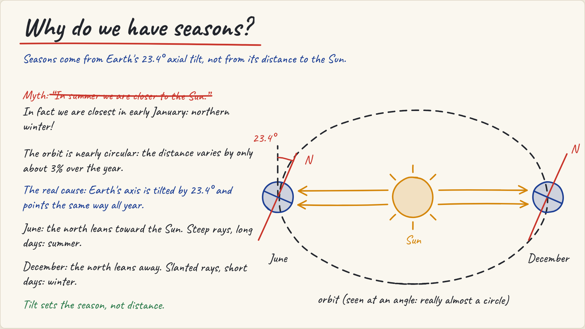
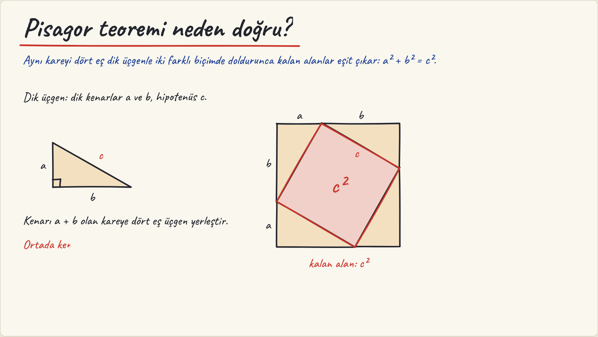
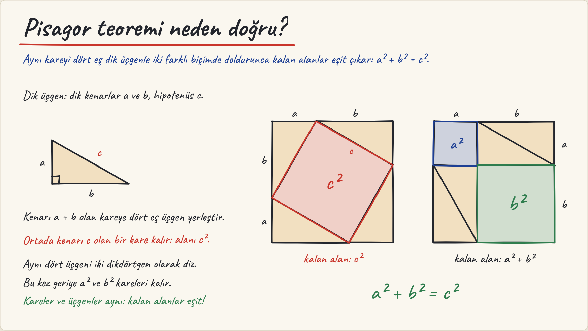
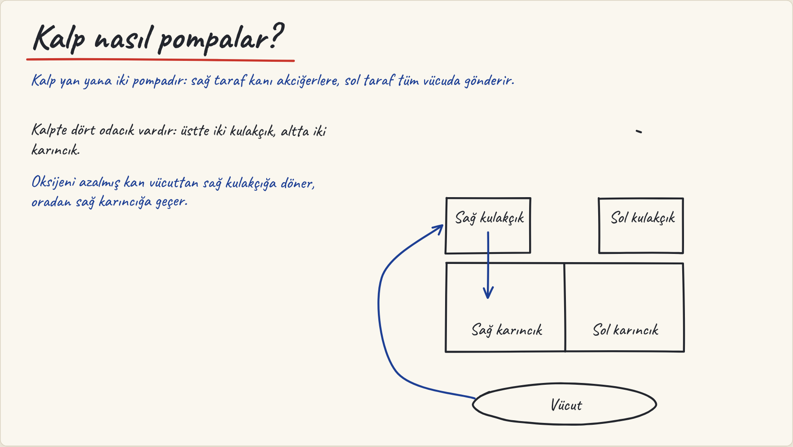
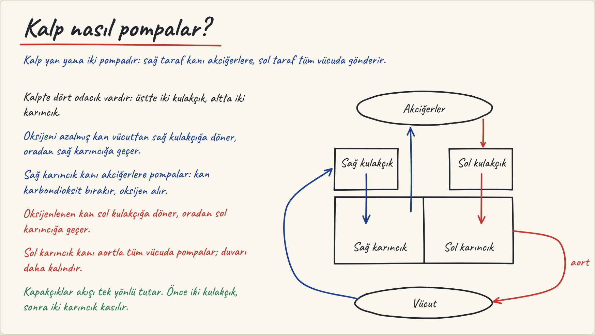

# tahta

*Türkçe: [README.tr.md](README.tr.md)*

Ask a question and watch the answer get written and drawn on a board, step by step, the way a teacher would explain it. "Tahta" is Turkish for "board".



Live demo (works without an API key): https://noirkrtx.github.io/tahta/

## What it does

- You type a question in Turkish or English. A language model answers with a structured **board scenario** (JSON), not with prose.
- The player draws that scenario on a fixed 1600×900 SVG board: the title is written and underlined, text lines appear left to right in a handwriting font, and shapes (circle, ellipse, rectangle, line, arrow, curve, angle arc, polyline, vector path) are drawn stroke by stroke with a slight hand wobble.
- Controls: play/pause, step back/forward, speed 0.5×–2×, restart, a scrub bar, and a clickable step list. Keyboard: space, ←, →.
- Export: scenario JSON (download and load, for sharing), final board as SVG or PNG.
- Five hand-written demo scenarios run with no key at all: seasons (Turkish and English), how the heart pumps, why the Pythagorean theorem holds, and photosynthesis.

| Mid-way | Finished |
| --- | --- |
|  |  |
|  |  |

The whole interface: [Turkish](docs/ekran/arayuz-tr.png), [English](docs/ekran/arayuz-en.png).

## Bring your own key

Your own questions need an Anthropic API key. There is no backend.

- The key is stored **only in your browser's localStorage** and is sent **only to `api.anthropic.com`**, directly from the page (`anthropic-dangerous-direct-browser-access: true`).
- Anything that can run script on the page's origin, including browser extensions, can read localStorage. Prefer a separate key with a spending limit, and remove it (Settings → Remove key) on shared machines.
- The model name is free text. The default is `claude-fable-5-2`; cheaper models work too, with simpler drawings.
- Generated boards can contain mistakes. The app says so next to every generated board; verify anything that matters.

## Run it locally

Requires Node 22 or newer (Vite 8).

```bash
npm ci
npm run dev        # development server
npm test           # vitest
npm run build      # type-check + production build into dist/
npm run preview    # serves dist/ under /tahta/, like GitHub Pages
```

The production build assumes it is served from `/tahta/` (see `vite.config.ts`). Change `base` there if you host it elsewhere.

Useful URL parameters: `?demo=mevsimler|seasons|kalp|pisagor|fotosentez`, `&at=0..1` (open paused at that fraction of the timeline), `&lang=tr|en`.

## Scenario format

A scenario is one JSON object. Full reference: [docs/SCHEMA.md](docs/SCHEMA.md); source of truth: [`src/schema.ts`](src/schema.ts).

```json
{
  "version": 1,
  "lang": "en",
  "title": "Why is the sky blue?",
  "summary": "Air scatters blue sunlight much more than red.",
  "steps": [
    {
      "title": "Sunlight is a mix",
      "narration": "Sunlight looks white but contains all colours.",
      "elements": [
        { "type": "text", "x": 60, "y": 270, "size": "sm", "text": "Sunlight = all colours mixed." },
        { "type": "circle", "cx": 820, "cy": 330, "r": 50, "color": "amber", "fill": "amber" },
        { "type": "arrow", "x1": 880, "y1": 350, "x2": 1180, "y2": 470, "color": "amber", "label": "sunlight" }
      ]
    }
  ]
}
```

Validation is strict: unknown fields, unknown element types, out-of-range numbers and non-whitelisted path commands are rejected. If the model's reply fails validation, the app sends the error list back once and asks for a corrected scenario; if that also fails you get a readable error instead of a broken board.

## How it is built

- Vite + TypeScript, no framework, no runtime dependencies.
- `src/schema.ts` validation · `src/rough.ts` seeded hand-drawn geometry · `src/layout.ts` text wrapping and overlap fix · `src/compile.ts` scenario → drawing operations · `src/timeline.ts` timing and step navigation · `src/board.ts` SVG rendering (`stroke-dashoffset` for strokes, clip rectangles for text) · `src/player.ts` playback · `src/llm.ts` + `src/prompt.ts` the model call · `src/export.ts` SVG/PNG.
- The picture is a pure function of time, so seeking, stepping back and exporting share one code path.
- Scenario text reaches the DOM only through `textContent`; path data is parsed and re-serialised from a whitelist.
- Handwriting font: [Caveat](https://github.com/googlefonts/caveat) (SIL Open Font License 1.1), bundled in `src/assets/fonts/` with its licence. A test reads the font files and checks that the Turkish alphabet and every character used in the demos are present.

Screenshots in `docs/ekran/` are produced by `scripts/ekran.py` (Python Playwright) from the production build; the script also exercises the keyboard controls and the exports.

## Limits

- One board per answer: nothing is erased, so long explanations have to fit 1600×900.
- The overlap fix only moves text blocks down; it does not untangle shapes or arrow labels. Model-generated layouts can still collide.
- The LLM path is tested against a fake API only. It has not been run against the real API in this repository's test suite.
- Text is revealed with a moving clip, not drawn glyph stroke by glyph stroke.
- No video export yet.
- Demos other than the seasons one exist in Turkish only.

## Contributing

Issues and pull requests are welcome. For a new demo scenario: add a JSON file to `examples/`, register it in `src/examples.ts`, run `npm test` (schema, canvas bounds and font coverage are checked) and regenerate screenshots with `python scripts/ekran.py`. Please check the facts in a scenario against a reliable source and keep simplifications labelled as such in the narration.

## Inspiration

Inspired by Tyler Nishida's chalkboard explainer demo shared by Anthropic (Nov 2026); independent implementation, no code reused.

## Licence

MIT, see [LICENSE](LICENSE). The bundled Caveat font is under the SIL Open Font License 1.1 (`src/assets/fonts/OFL.txt`).
