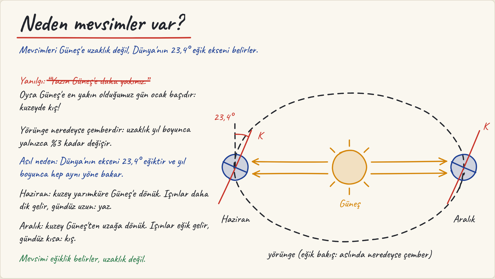
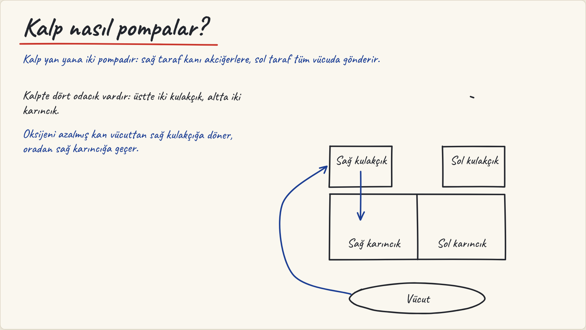
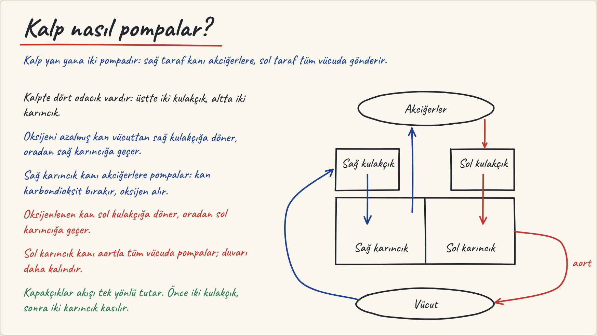
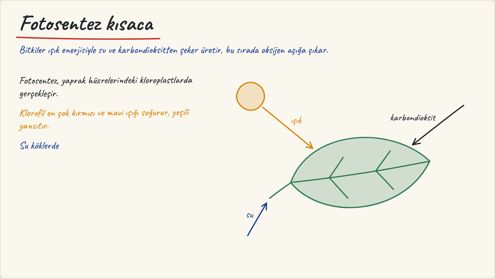
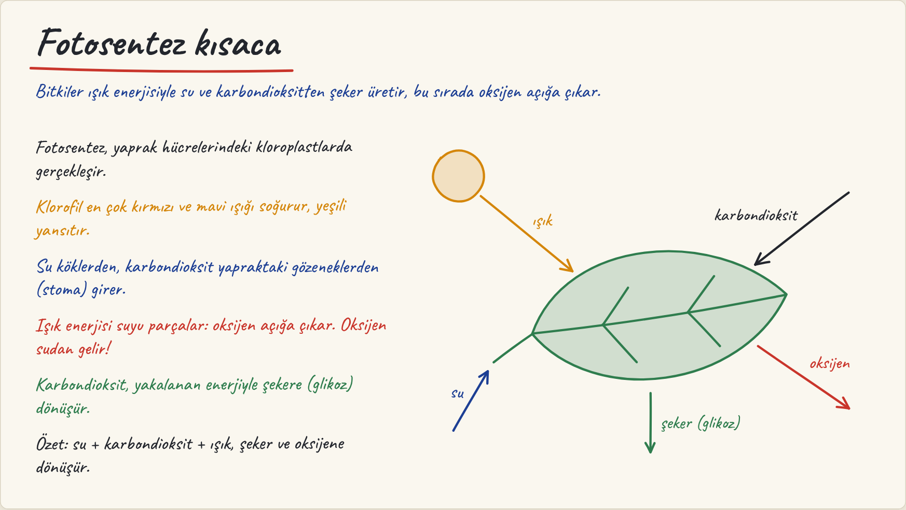

# tahta

*English: [README.md](README.md)*

Bir soru sor; cevap, bir öğretmenin anlatacağı gibi tahtaya adım adım yazılsın ve çizilsin.



Canlı demo (API anahtarı olmadan çalışır): https://noirkrtx.github.io/tahta/

## Ne yapar

- Soruyu Türkçe ya da İngilizce yazarsın. Dil modeli düzyazı yerine yapılandırılmış bir **tahta senaryosu** (JSON) döndürür.
- Oynatıcı bu senaryoyu 1600×900'lük sabit bir SVG tahtaya çizer: başlık yazılır ve altı çizilir, metin satırları el yazısı fontuyla soldan sağa belirir, şekiller (daire, elips, dikdörtgen, çizgi, ok, eğri, açı yayı, kırık çizgi, vektör yol) hafif el titremesiyle darbe darbe çizilir.
- Kontroller: oynat/duraklat, adım geri/ileri, hız 0,5×–2×, baştan, ilerleme çubuğu ve tıklanabilir adım listesi. Klavye: boşluk, ←, →.
- Dışa aktarma: senaryo JSON'u (indir ve yükle; paylaşım için), tahtanın son hali SVG ya da PNG.
- Elle yazılmış beş hazır senaryo anahtarsız çalışır: mevsimler (Türkçe ve İngilizce), kalbin pompalaması, Pisagor teoremi, fotosentez.

| Ara kare | Son kare |
| --- | --- |
|  |  |
|  |  |

Arayüzün tamamı: [Türkçe](docs/ekran/arayuz-tr.png), [İngilizce](docs/ekran/arayuz-en.png).

## Kendi anahtarınla (BYOK)

Kendi sorun için bir Anthropic API anahtarı gerekir. Arka uç sunucusu yoktur.

- Anahtar **yalnız tarayıcının localStorage alanında** saklanır ve **yalnız `api.anthropic.com` adresine**, doğrudan sayfadan gönderilir (`anthropic-dangerous-direct-browser-access: true`).
- Sayfanın kökeninde kod çalıştırabilen her şey, tarayıcı eklentileri dahil, localStorage'ı okuyabilir. Harcama sınırı olan ayrı bir anahtar kullan; ortak bilgisayarda işin bitince anahtarı sil (Ayarlar → Anahtarı sil).
- Model adı serbest metindir. Varsayılan `claude-fable-5-2`; daha ucuz modeller de çalışır, çizimler daha sade olur.
- Modelin ürettiği tahta hata içerebilir. Uygulama bunu üretilen her tahtanın altında belirtir; önemli bilgiyi doğrula.

## Claude hesabınla kullan (artifact)

[`artifact/tahta-artifact.html`](artifact/tahta-artifact.html) uygulamanın tek dosyalık hali (JS, CSS, font ve hazır örnekler içinde, yaklaşık 260 KiB, ağ isteği yok). Claude içinde artifact olarak açıldığında Claude'a `window.claude.complete` ile sorar: API anahtarı gerekmez, kullanım giriş yapmış kişinin kendi Claude planından düşer. Claude dışında yukarıdaki anahtarlı kipe döner.

1. Dosyayı üret ya da depodaki kopyayı kullan: `npm ci && npm run build:artifact`.
2. Claude Code ile (Pro, Max, Ultra, Team ya da Enterprise; `/login` ile giriş yapılmış): bu klasörde `claude` başlat ve *"artifact/tahta-artifact.html dosyasını hiç değiştirmeden artifact olarak yayımla"* de.
3. Ya da claude.ai / Claude Desktop'ta bir sohbette (*Settings > Capabilities > Cloud code execution and file creation* açıkken): dosyayı ekle, Claude'dan onu değiştirmeden HTML artifact olarak açmasını iste. Artifact ilk kez izin istediğinde Claude erişimine izin ver.
4. Artifact'teki **Share** ile paylaş.

Sınırlar: model seçimi yok; görüntüleyici sayfanın kendi başlattığı indirmeleri engellediği için dışa aktarma düğmeleri gizli. Anthropic'in yardım sayfalarına göre kişisel planlarda paylaşılan bir artifact'in Claude kullanan bölümleri senden başkası için çalışmıyor (Team ya da Enterprise kuruluşunun üyeleri kullanabiliyor). İşlevin adı Anthropic'in herkese açık belgelerinde yok ve adımlar gerçek bir Claude hesabında denenmedi. Ayrıntılar, alıntılar ve kaynaklar: [artifact/README.md](artifact/README.md).

## Yerelde çalıştırma

Node 22 ya da üstü gerekir (Vite 8).

```bash
npm ci
npm run dev        # geliştirme sunucusu
npm test           # vitest
npm run build      # tip denetimi + dist/ içine üretim derlemesi
npm run preview    # dist/ klasörünü GitHub Pages gibi /tahta/ altında sunar
npm run build:artifact  # tek dosyalık artifact/tahta-artifact.html
```

Üretim derlemesi `/tahta/` yolundan sunulacağını varsayar (`vite.config.ts`). Başka yerde barındıracaksan oradaki `base` değerini değiştir.

Yararlı URL parametreleri: `?demo=mevsimler|seasons|kalp|pisagor|fotosentez`, `&at=0..1` (zaman çizgisinin o oranında duraklatılmış açar), `&lang=tr|en`.

## Senaryo biçimi

Senaryo tek bir JSON nesnesidir. Tam başvuru: [docs/SCHEMA.md](docs/SCHEMA.md); asıl kaynak: [`src/schema.ts`](src/schema.ts).

```json
{
  "version": 1,
  "lang": "tr",
  "title": "Gökyüzü neden mavi?",
  "summary": "Hava, mavi ışığı kırmızıdan çok daha fazla saçar.",
  "steps": [
    {
      "title": "Güneş ışığı bir karışımdır",
      "narration": "Güneş ışığı beyaz görünür ama bütün renkleri içerir.",
      "elements": [
        { "type": "text", "x": 60, "y": 270, "size": "sm", "text": "Güneş ışığı = bütün renkler." },
        { "type": "circle", "cx": 820, "cy": 330, "r": 50, "color": "amber", "fill": "amber" },
        { "type": "arrow", "x1": 880, "y1": 350, "x2": 1180, "y2": 470, "color": "amber", "label": "güneş ışığı" }
      ]
    }
  ]
}
```

Doğrulama sıkıdır: bilinmeyen alanlar, bilinmeyen öğe türleri, aralık dışı sayılar ve izinli olmayan yol komutları reddedilir. Modelin yanıtı doğrulamadan geçmezse uygulama hata listesini bir kez geri gönderip düzeltilmiş senaryo ister; o da geçersizse bozuk bir tahta yerine anlaşılır bir hata gösterir.

## Nasıl yapıldı

- Vite + TypeScript; çerçeve yok, çalışma zamanı bağımlılığı yok.
- `src/schema.ts` doğrulama · `src/rough.ts` tohumlu el çizimi geometrisi · `src/layout.ts` satır kaydırma ve çakışma düzeltmesi · `src/compile.ts` senaryo → çizim işlemleri · `src/timeline.ts` zamanlama ve adım gezinme · `src/board.ts` SVG çizimi (darbeler için `stroke-dashoffset`, metin için kırpma dikdörtgeni) · `src/player.ts` oynatma · `src/llm.ts` + `src/prompt.ts` model çağrısı (Claude içinde `src/llm-artifact.ts`) · `src/export.ts` SVG/PNG.
- Görüntü zamanın saf bir fonksiyonudur; ileri-geri sarma, adım geri alma ve dışa aktarma aynı kod yolunu kullanır.
- Senaryo metni DOM'a yalnız `textContent` ile girer; yol verisi izinli komut listesine göre ayrıştırılıp yeniden yazılır.
- El yazısı fontu: [Caveat](https://github.com/googlefonts/caveat) (SIL Open Font License 1.1); lisansıyla birlikte `src/assets/fonts/` altında. Bir test font dosyalarını okuyup Türk alfabesinin ve demolarda kullanılan her karakterin fontta bulunduğunu denetler.

`docs/ekran/` altındaki görüntüleri `scripts/ekran.py` (Python Playwright) üretim derlemesinden alır; aynı kod klavye kontrollerini ve dışa aktarmayı da dener. `scripts/artifact_check.py` aynısını tek dosyalık artifact için sahte bir `window.claude` ile yapar ([docs/ekran/artifact.png](docs/ekran/artifact.png)).

## Sınırlar

- Her cevap tek tahtadır: hiçbir şey silinmez, uzun anlatımın 1600×900'e sığması gerekir.
- Çakışma düzeltmesi yalnız metin bloklarını aşağı iter; şekilleri ve ok etiketlerini ayırmaz. Modelin ürettiği yerleşimde çakışma kalabilir.
- LLM yolu yalnız sahte bir API ile test edildi. Bu deponun testlerinde gerçek API'ye çağrı yapılmadı. Artifact yolu da yalnız sahte bir `window.claude` ile denendi.
- Metin, hareket eden bir kırpma ile belirir; harfler tek tek kalem darbesiyle çizilmez.
- Video dışa aktarma henüz yok.
- Mevsimler dışındaki demolar yalnız Türkçedir.

## Katkı

Hata kaydı ve değişiklik isteği açabilirsin. Yeni demo senaryosu için: `examples/` altına bir JSON ekle, `src/examples.ts` içine kaydet, `npm test` çalıştır (şema, tuval sınırları ve font kapsamı denetlenir), ekran görüntülerini `python scripts/ekran.py` ile yenile. Senaryodaki bilgileri güvenilir bir kaynaktan doğrula; basitleştirmeleri sözlü açıklamada açıkça belirt.

## Esin

Inspired by Tyler Nishida's chalkboard explainer demo shared by Anthropic (Nov 2026); independent implementation, no code reused.

(Anthropic'in Kasım 2026'da paylaştığı, Tyler Nishida'nın tahta anlatım demosundan esinlenildi; bağımsız bir uygulamadır, o projeden kod kullanılmadı.)

## Lisans

MIT, bkz. [LICENSE](LICENSE). Depodaki Caveat fontu SIL Open Font License 1.1 kapsamındadır (`src/assets/fonts/OFL.txt`).
